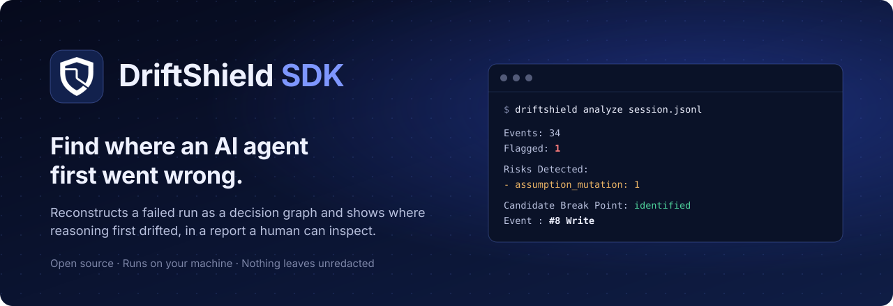
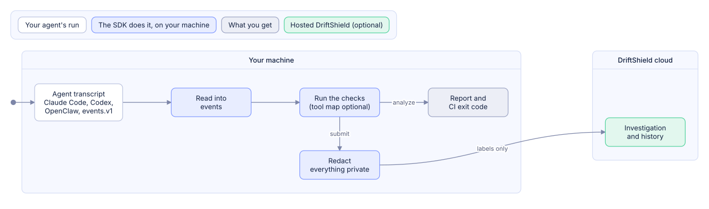
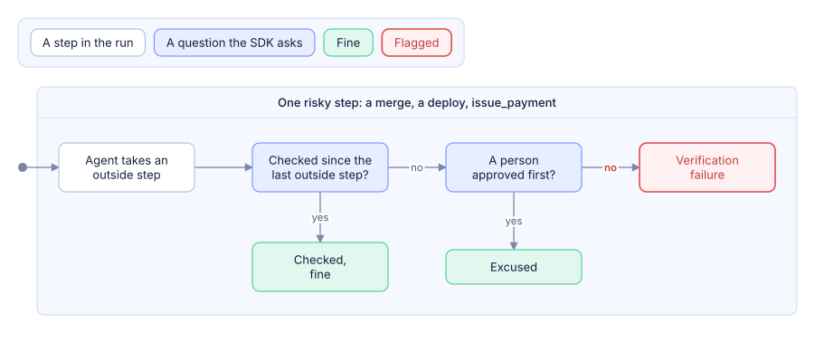
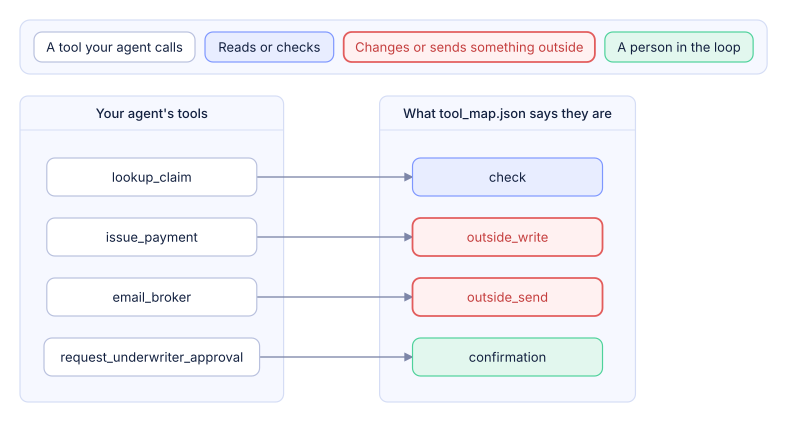

<p align="center">
  
</p>

<p align="center">
  <b>Find where an AI agent first went wrong.</b><br>
  Open source failed-run investigation for AI workflows. Runs on your machine.
</p>

<p align="center">
  <a href="https://pypi.org/project/driftshield-sdk/"></a>
  
  <a href="LICENSE"></a>
  <a href="https://github.com/driftshield/driftshield-sdk/actions/workflows/ci.yml"></a>
  
</p>

---

DriftShield is an open source failed-run investigation tool for AI workflows. When a run
breaks, teams often fall back on logs, traces, and guesswork. DriftShield reconstructs the run
as a decision graph, shows where reasoning first drifted, and turns the failure into a
report a human can inspect.

As teams move from single prompts to multi-step and agentic workflows, failures become harder to
explain. A workflow can follow the right steps but still produce the wrong outcome, acknowledge a
constraint and then ignore it, or behave inconsistently across runs.

The OSS core focuses on one failed run at a time. It helps teams explain what happened, inspect
where the run broke, recognise known failure mechanisms within that run, and produce an
investigation-grade artefact for debugging, review, and follow-up.

## Why DriftShield

- Move from raw logs and traces to an inspectable failure investigation
- See where a workflow broke and how the run drifted off course
- Recognise known failure mechanisms within a single failed run
- Give engineers and product teams a shared artefact for debugging and review

## Built For

- AI engineers building multi-step or agentic workflows
- Product teams shipping AI-powered features
- Teams where reliability and correctness matter

## What it checks

- **Finished when it was not.** A tool failed, the agent did not try again and still gave its answer. Or it answered without looking up what it needed. Or the run ended on an error nothing fixed.
- **Acted without checking.** The agent merged a pull request it opened or pushed to, with no read of it since. With a tool map, a write, send or delete outside your own systems with no check since the last one and no person approving it first.
- **Wrote over a change.** A write that clashed with something the agent read earlier, with no confirmation between.
- **Drift inside the run.** The five built-in risk detectors below, on every step.
- **Your own tools.** A small JSON tool map says what tools such as `issue_payment` or `email_broker` do, so their steps are judged too.

## Quick start

Needs Python 3.12 or later.

```bash
pip install driftshield-sdk

# Analyse one run: a file path, or a Claude Code session id
driftshield analyze <session-id-or-path>

# Tell it what your own tools do
driftshield analyze --tool-map tool_map.json run.jsonl

# Upload a redacted copy for hosted investigation (optional)
driftshield submit --path run.jsonl
```

Try the worked example in this repo, an insurance claims agent:

```console
$ driftshield analyze docs/examples/insurance-claims/session.jsonl \
    --tool-map docs/examples/insurance-claims/tool_map.json
...
Signature hits: mechanism:verification_failure
```

The payment and the email to the broker went out with no fresh check, so verification failure fires.

To run the local API and dashboard from a clone, see [docs/self-host.md](docs/self-host.md).

## Demo

A walk through the local dashboard: triage flagged runs, open one as a decision
graph, inspect the inflection node, and read the generated forensic report.

<!--
  To use the higher-quality MP4 instead of the inline GIF: drag
  driftshield-dashboard-demo.mp4 into a GitHub comment to get a
  user-attachments URL, then replace the  below with:
  <video src="<that-url>" controls width="100%"></video>
-->


## How it works

<p align="center">
  
</p>

```
Transcript → Parser → Canonical Events → Decision Graph → Risk Heuristics → Report
```

1. **Parsers** read raw transcripts and produce a sequence of canonical events (tool calls, outputs, branches, handoffs, assumptions, constraint checks)
2. **Graph builder** connects events into a decision tree with parent/child relationships
3. **Risk heuristics** scan every node for failure patterns
4. **Inflection detection** scores points in the session where the agent's trajectory changed
5. **Reports** present findings as Markdown, JSON, or through the web dashboard

### One risky step

<p align="center">
  
</p>

A check only covers the next outside step after it. For a merge, the check is a read of that same pull request. More in [docs/how-checks-work.md](docs/how-checks-work.md).

## Built-in Risk Detectors

| Detector | What it catches |
|----------|----------------|
| Coverage Gap | Output references fewer items than the input provided |
| Assumption Mutation | An assumption changed between steps without acknowledgement |
| Policy Divergence | Agent behaviour contradicts an earlier stated constraint |
| Constraint Violation | An explicit constraint was checked and then ignored |
| Context Contamination | Information from one context leaks into an unrelated decision |

Risk detectors are additive. Each implements a `RiskHeuristic` interface and can be extended without modifying existing code.

## The tool map

<p align="center">
  
</p>

A shell step is judged from its command line. Any other tool (`issue_payment`, `cancel_policy`, `email_broker`) is judged when a tool map says what it does:

```json
{"version": 1, "coding_defaults": false,
 "tools": {"lookup_claim": "check", "issue_payment": "outside_write",
           "email_broker": "outside_send", "cancel_policy": "delete_outside",
           "request_underwriter_approval": "confirmation", "transfer_to_human": "handoff",
           "log_note": "ignore"}}
```

Kinds: `read` (changes nothing), `check` (reads the thing about to be changed), `outside_write`, `outside_send` (sends data beyond your own systems), `delete_outside`, `confirmation` (a person was asked and answered), `handoff`, `ignore`, and for coding agents `shell` and `file_write`. The coding agent tools are in the default map. Pass it with `driftshield analyze --tool-map map.json` (or `DRIFTSHIELD_TOOL_MAP`). Only tool names are read, never arguments.

## In CI

```bash
driftshield analyze run.jsonl --fail-on constraint_violation,policy_divergence
driftshield analyze run.jsonl --fail-threshold 1
```

`--fail-on` exits 1 when any of the named risks fires (`assumption_mutation`, `policy_divergence`, `constraint_violation`, `context_contamination`, `coverage_gap`). `--fail-threshold N` exits 1 when N or more steps are flagged. For many files at once, `driftshield batch <directory-or-archive> --json`.

## Supported Sources

| Source | Format | Status |
|--------|--------|--------|
| Claude Code | JSONL | Stable |
| ChatGPT export | JSON | Experimental |
| Claude Desktop | JSON | Experimental |
| Codex CLI | JSONL | Experimental |
| Codex Desktop | JSON | Experimental |
| OpenClaw | JSONL | Experimental |
| LangChain / LangSmith export | JSON | Experimental |
| CrewAI run export | JSON | Experimental |
| Your own agent (`driftshield.events.v1`) | JSONL | Experimental |

ChatGPT export reads one conversation from `conversations.json` (the branch ending at `current_node`).

Codex CLI covers the rollout files under `~/.codex/sessions/`; the Codex app and its VS Code extension write the same files.

For an agent with none of these formats (an insurance claims agent, a support agent), write
its log as `driftshield.events.v1` JSON Lines and say what each tool does in a tool map. See
[docs/events-v1.md](docs/events-v1.md) and the worked insurance example in
[docs/examples/insurance-claims](docs/examples/insurance-claims).

DriftShield uses a parser protocol. New sources can be added by implementing a single interface.

## Privacy

`driftshield submit` is the customer upload command. The client redacts the transcript locally before upload. No raw transcript data leaves the machine unredacted.

- Prompts, code, tool inputs and outputs, file contents, paths and error text are replaced with placeholders.
- What stays is a small, fixed set of labels per step, for example `command_kind: merge` or `checked_before: false`. The value of each field is checked against its list before it is written, so a mistake in the classifier can only produce `unknown`, never free text.
- `driftshield analyze` works fully on your machine. Only `submit` uploads.
- Inspect what the redactor would strip, without uploading: `driftshield submit --path <session.json> --dry-run-redaction`.

Why keep any labels at all: a run that pushed to the main branch without any earlier check is a very different run from one that listed a directory, and the placeholder hides the difference. The full list is in [docs/privacy.md](docs/privacy.md).

## Hosted DriftShield

This public repo is the OSS recognition and investigation layer.

It includes:

- transcript parsing and ingestion
- per-run investigation and reporting
- community signature-pack support
- public-safe dashboards, CLI flows, and API paths for failed-run analysis

Upload a run for hosted investigation with `driftshield submit`.

OSS community lane (unauthenticated):

```bash
driftshield submit --path <session.json>
```

Teams lane (authenticated; requires `DRIFTSHIELD_API_KEY`):

```bash
DRIFTSHIELD_API_KEY=... driftshield submit --path <session.json> --tier teams
```

Pass `--include-analysis` to attach the local matcher verdict. The hosted investigation then uses the same verdict your local matcher produced:

```bash
driftshield submit --path <session.json> --include-analysis
```

The hosted intel layer persists the investigation and makes it available on the investigation surface.
Every tier uses the same built-in DriftShield address; the API key decides the workspace. Teams and Enterprise customers need only `DRIFTSHIELD_API_KEY` and `--tier teams`; no other configuration is needed.

## CLI Reference

After `pip install driftshield-sdk`, or from the `driftshield/` directory of a clone after `source .venv/bin/activate`.

```bash
# Upload a session for hosted failure investigation (OSS community lane)
driftshield submit --path <session.json>

# Upload with local matcher verdict attached (hosted investigation matches local result)
driftshield submit --path <session.json> --include-analysis

# Upload via the Teams lane (requires DRIFTSHIELD_API_KEY)
DRIFTSHIELD_API_KEY=... driftshield submit --path <session.json> --tier teams

# Inspect what the redactor would strip, without uploading
driftshield submit --path <session.json> --dry-run-redaction
driftshield submit --path <session.json> --show-manifest

# Feed the local self-hosted dashboard (direct upload to /api/ingest)
driftshield ingest --path <file.jsonl>
driftshield ingest --latest

# List ingested sessions
driftshield list

# Analyse a session for risk signals
driftshield analyze <session-id-or-path>

# Say what your own tools do, so their steps are judged too
driftshield analyze <file.jsonl> --tool-map tool_map.json

# Exit 1 in CI when a named risk fires, or when N or more steps are flagged
driftshield analyze <file.jsonl> --fail-on constraint_violation,policy_divergence
driftshield analyze <file.jsonl> --fail-threshold 1

# Inspect a specific node in the decision graph
driftshield inspect <file.jsonl> --node 0

# Generate a report (defaults to the full report; use --type summary for a short one)
driftshield report <file.jsonl>

# Generate a JSON report contract from the CLI
driftshield report <file.jsonl> --format json

# Discover and list local transcript connectors
driftshield connectors discover
driftshield connectors list

# Analyse every transcript in a directory or archive, without aborting on a bad file
driftshield batch <directory-or-archive>

# Same, plus submit every successfully analysed file (opt-in; no --submit means no network call)
driftshield batch <directory-or-archive> --submit

# Machine-readable batch report
driftshield batch <directory-or-archive> --json
```

## Library use

The engine has two public calls, `analyse_run` and `submit`; the CLI is a thin skin over them.

```python
from driftshield import analyse_run, submit

run = analyse_run(open("session.jsonl", "rb").read(), source="session.jsonl")
print(run.detected_format, run.qualification_state, [h.signature_id for h in run.signature_hits])
receipt = submit(run)  # community lane: keyless, redacted
```

With a tool map:

```python
from driftshield.tool_map import load_tool_map

run = analyse_run(open("run.jsonl", "rb").read(), tool_map=load_tool_map("tool_map.json"))
run.signature_hits   # for example verification_failure
```

[`docs/public-api.md`](docs/public-api.md) documents both calls, their types and error modes.

## Docs

- [How DriftShield checks a run](docs/how-checks-work.md): the pipeline, the tool map, what counts as a failure and the OSS scope.
- [What leaves your machine](docs/privacy.md): every label that is sent for each step.
- [Run DriftShield from a clone](docs/self-host.md): the local API, dashboard, Docker and project structure.
- [Neutral event format](docs/events-v1.md): log any agent so DriftShield can read it.
- [Public API](docs/public-api.md): `analyse_run` and `submit`.
- [Community signature packs](docs/signature-packs.md)
- [OpenClaw connector](docs/openclaw-connector.md)
- [Changelog](CHANGELOG.md)

## Contributing

Contributions are welcome. DriftShield is founded and maintained by Tomasz Borys, and pull requests are reviewed with that founder-led OSS scope in mind. Please follow these steps:

1. **Fork** the repository to your own GitHub account
2. **Clone** your fork locally
3. **Create a branch** from `main` for your change
4. **Make your changes** with tests where applicable
5. **Run verification** before submitting:
   ```bash
   ./scripts/dev-verify.sh
   ```
6. **Open a pull request** from your fork's branch to `driftshield/driftshield-sdk:main`

All pull requests are reviewed and merged by Tomasz Borys, DriftShield's founder and current maintainer. Direct pushes to `main` are not accepted.

### Code style

- Python: Ruff (line length 100), MyPy strict, conventional commits
- TypeScript: ESLint 9 flat config, strict mode, no `any` types
- Tailwind CSS for frontend styling

### Adding a parser

Implement the `ParserProtocol` interface in `driftshield/src/driftshield/parsers/`. Each parser converts a raw transcript format into a list of `CanonicalEvent` objects. See `claude_code.py` for a reference implementation.

## Licence

AGPL-3.0-or-later. See [LICENSE](./LICENSE).
